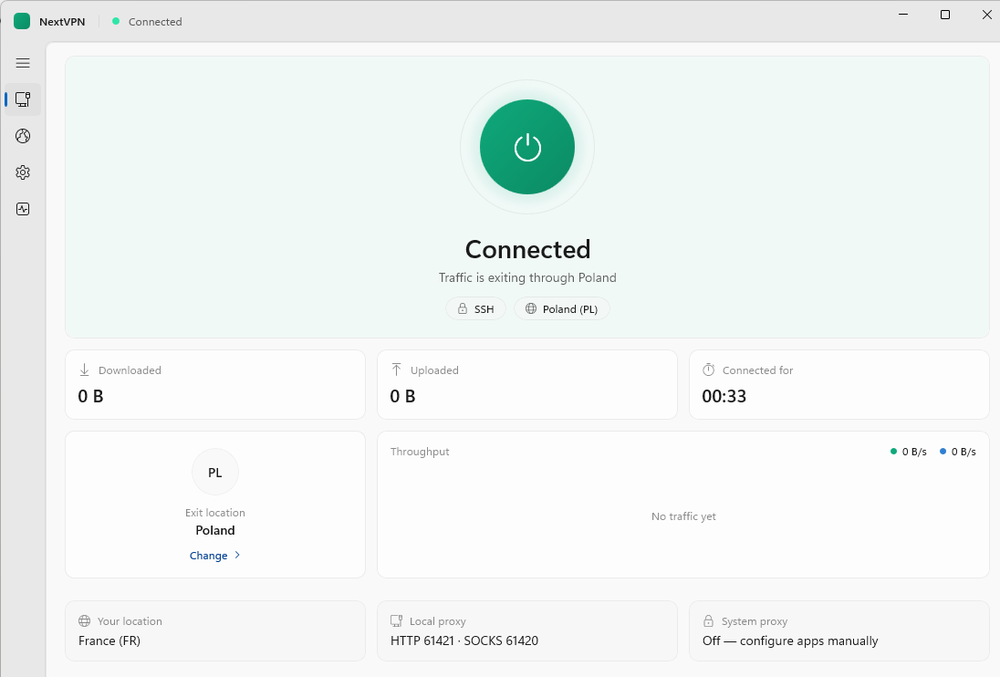
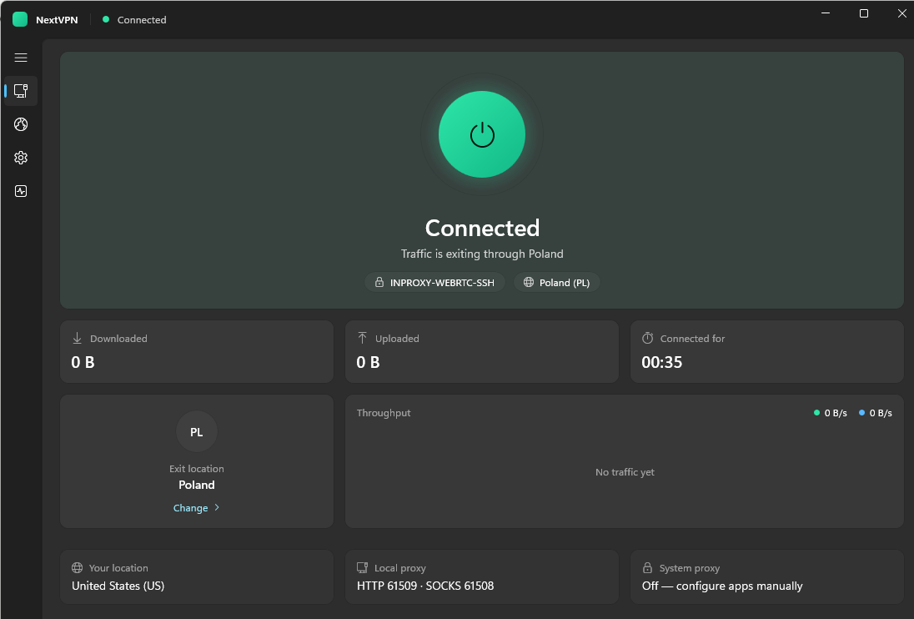
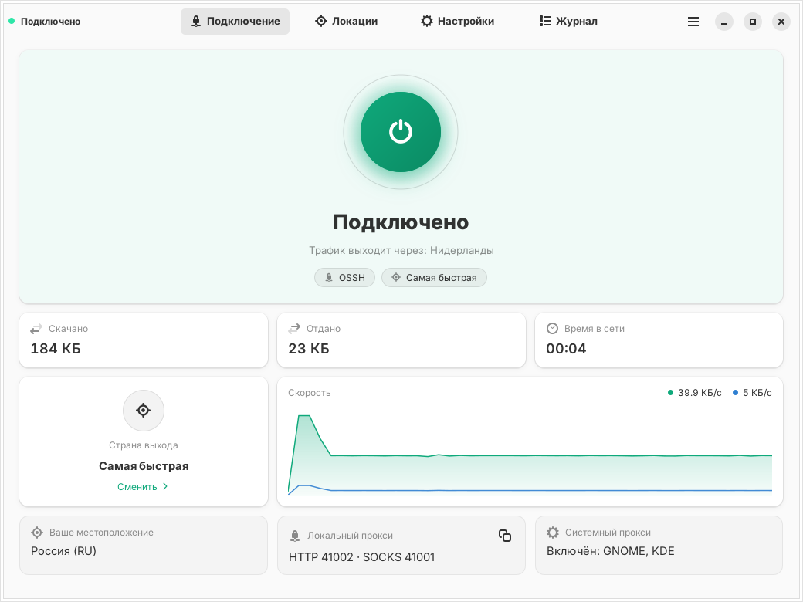

  

# NextVPN

### Свободный интернет в один клик

---

## Скачать

[Версия без установки](https://github.com/Just-ElC/NextVPN/releases/latest/download/NextVPN-1.0.0-win-x64.zip) · [все версии](https://github.com/Just-ElC/NextVPN/releases)

**Linux** (GTK 4): [Fedora · CachyOS / Arch · NixOS · Ubuntu и другие](#linux)

**Без регистрации · без подписки · без ограничений по трафику**

---

---

## Установка

1. Скачайте и запустите файл.
2. Windows покажет синее окно — нажмите **«Подробнее»**, затем **«Выполнить в любом случае»**.
3. Если появится просьба установить **.NET 8** — согласитесь, поставьте его и запустите файл снова.
4. Нажмите **«Да»**.

Через несколько секунд **NextVPN** появится в меню «Пуск». Права администратора не нужны.

---

## Как пользоваться

1. Нажмите большую круглую кнопку.
2. Дождитесь надписи **Connected** — всё, интернет уже свободен. Ничего настраивать не нужно.
3. Хотите другую страну — откройте **Locations** и выберите из списка.
4. Нажмите кнопку ещё раз, чтобы отключиться.

Окно можно закрыть — приложение свернётся к часам в углу экрана и продолжит работать.

---

## Что умеет

| | |
|---|---|
| **Одна кнопка** | Никаких серверов, ключей и настроек — просто нажать |
| **Выбор страны** | Список стран с поиском, переключение на лету |
| **Работает во всех программах** | Браузеры и приложения подхватывают соединение сами |
| **Светлая и тёмная тема** | Подстраивается под оформление Windows |
| **Живёт в трее** | Не мешает, не занимает место на панели задач |
| **Автозапуск** | Может включаться вместе с Windows и сразу подключаться |
| **Скорость на виду** | Видно, сколько скачано, отдано и как долго вы онлайн |
| **Ничего лишнего** | Не показывает рекламу, не просит почту, не собирает данные |

---

## Тёмная тема

---

## Linux

Версия для Linux на GTK 4 и libadwaita: тот же движок, **те же серверы** и все те же
возможности — одна кнопка, выбор страны, трей, автозапуск, светлая и тёмная тема.
Системный прокси включается в GNOME и KDE Plasma. Подробности — в
[linux/README.md](linux/README.md).

| Система | Как установить |
|---|---|
| **Fedora** | `linux/packaging/fedora/build-rpm.sh`, затем `sudo dnf install ~/rpmbuild/RPMS/x86_64/nextvpn-*.rpm` |
| **CachyOS, Arch, Manjaro** | `cd linux/packaging/arch && makepkg -si` |
| **NixOS** | `nix run github:Just-ElC/NextVPN` или модуль `programs.nextvpn.enable = true` |
| **Ubuntu, Debian и другие** | `linux/install.sh --deps && linux/install.sh` — в домашнюю папку, без прав администратора |

---

## Частые вопросы

**Это бесплатно?**  
Да, полностью и без ограничений.

**Нужна регистрация?**  
Нет. Скачали, запустили, нажали кнопку.

**Почему Windows предупреждает при запуске?**  
Так происходит с любой небольшой программой без платного сертификата разработчика — он стоит денег и ежегодно продлевается. Нажмите «Подробнее» → «Выполнить в любом случае».

**Куда всё установится?**  
В вашу личную папку пользователя. Другие пользователи компьютера ничего не заметят, права администратора не нужны.

**Как удалить?**  
«Параметры» → «Приложения» → «Установленные приложения» → **NextVPN** → «Удалить».

**Работает ли во всех программах?**  
Браузеры и большинство приложений — сразу. Отдельные игры и программы, которые не смотрят на сетевые настройки Windows, могут ходить в обход.

**А в Linux?**  
Браузеры и программы, которые берут системный прокси GNOME или KDE, — сразу. Для терминала NextVPN даёт готовую команду с переменными прокси (кнопка у «Локального прокси»). В GNOME для значка в трее нужно расширение AppIndicator.

---

## NextVPN

### Первая часть [NextOS](https://github.com/Just-ElC)

Работает на открытом движке [Psiphon](https://github.com/Psiphon-Labs/psiphon-tunnel-core) (лицензия GPLv3). 
NextVPN — независимое приложение, не связано с Psiphon Inc.

